# CAMS EAC4 Exploratory Data Analysis

## 1. Dataset overview

Source: `cams-global-reanalysis-eac4`, các file GRIB tải bằng `src/download_cams_dataset.py`.
[Dataset chính thức CAMS EAC4](https://ads.atmosphere.copernicus.eu/datasets/cams-global-reanalysis-eac4).
Giai đoạn cấu hình: 2003–2025; giai đoạn quan sát thực tế: 2003-01-01 00:00:00 — 2025-12-31 21:00:00 UTC.
Lịch downloader: 00:00, 03:00, 06:00, 09:00, 12:00, 15:00, 18:00, 21:00 UTC, cadence 0 days 03:00:00.
Area [North, West, South, East]: [24.0, 102.0, 8.0, 110.0]. Phạm vi phân tích là bounding box, gồm đất liền ngoài Việt Nam và biển; không có country mask.

Available: pm1, pm2p5, pm10, u10, v10, t2m, d2m, sp, mslp, aod550, co_column, no2_column, so2_column, o3_column.
Missing: không có.
Không chọn trong lần chạy này: không có.

Đọc được 14/14 biến khai báo: pm1, pm2p5, pm10, u10, v10, t2m, d2m, sp, mslp, aod550, co_column, no2_column, so2_column, o3_column. Thiếu: không có. Giai đoạn quan sát: 2003-01-01 00:00:00 — 2025-12-31 21:00:00 UTC.

Grid của pm1: 22 × 11 điểm, bước latitude 0.75°, longitude 0.75°; 67,208 timestamp.

[Inventory đầy đủ, metadata và trạng thái từng biến](tables/inventory.csv).

File thừa hoặc bản thay thế:

Không có dữ liệu đủ điều kiện cho bảng này.

File lỗi/không rõ bản cần dùng:

Không có dữ liệu đủ điều kiện cho bảng này.

## 2. Data quality

So với pm1, 14/14 biến cùng trục thời gian và 14/14 biến cùng grid theo đúng thứ tự tọa độ. Tổng timestamp thiếu so với giai đoạn cấu hình (cộng qua biến): 0; message trùng: 224.

Các message trùng: 224 bản có cùng decoded values/grid với bản đầu, 0 bản xung đột. Bản giống nhau dùng representation đầu của cfgrib có audit rõ ràng; bản xung đột không được dùng cho analysis liên biến.

Các trường được thống kê có 102,682 NaN và 0 infinity; bao gồm biến dẫn xuất và ratio, nên không xem tổng này là số missing của raw riêng biệt.

PM1 <= PM2.5 <= PM10: 8/16,264,336 điểm vi phạm (4.919e-05%).

dewpoint <= temperature: 79/16,264,336 điểm vi phạm (0.0004857%).

0 <= RH <= 100: 12,763/16,264,336 điểm vi phạm (0.07847%).

Magnus formula range (-45 to 60 °C): 0/16,264,336 điểm vi phạm (0%).

| variable | same_time_grid | same_spatial_grid | missing_timestamps | internal_missing_timestamps | duplicate_timestamps | duplicate_messages | irregular_intervals | latitude_order |
| --- | --- | --- | --- | --- | --- | --- | --- | --- |
| pm1 | True | True | 0 | 0 | 0 | 0 | 0 | descending |
| pm2p5 | True | True | 0 | 0 | 0 | 0 | 0 | descending |
| pm10 | True | True | 0 | 0 | 0 | 0 | 0 | descending |
| u10 | True | True | 0 | 0 | 0 | 224 | 0 | descending |
| v10 | True | True | 0 | 0 | 0 | 0 | 0 | descending |
| t2m | True | True | 0 | 0 | 0 | 0 | 0 | descending |
| d2m | True | True | 0 | 0 | 0 | 0 | 0 | descending |
| sp | True | True | 0 | 0 | 0 | 0 | 0 | descending |
| mslp | True | True | 0 | 0 | 0 | 0 | 0 | descending |
| aod550 | True | True | 0 | 0 | 0 | 0 | 0 | descending |
| co_column | True | True | 0 | 0 | 0 | 0 | 0 | descending |
| no2_column | True | True | 0 | 0 | 0 | 0 | 0 | descending |
| so2_column | True | True | 0 | 0 | 0 | 0 | 0 | descending |
| o3_column | True | True | 0 | 0 | 0 | 0 | 0 | descending |

[Chi tiết khác biệt tọa độ, cadence, missing và duplicate examples](tables/consistency.csv).
Missing timestamp so với toàn giai đoạn cấu hình bao gồm các khoảng thiếu ở đầu/cuối; internal missing chỉ xét trong giai đoạn quan sát của từng file.
Duplicate GRIB message được quét bằng ecCodes trước khi dùng output cfgrib. Mỗi bản trùng được so sánh toàn bộ decoded values và grid geometry với bản đầu. Bản giống nhau có thể dùng representation đầu của cfgrib, được ghi rõ trong audit; nếu xung đột hoặc chưa kiểm chứng thì analysis liên biến bị bỏ qua. Thống kê đơn biến ghi rõ chính sách bản đầu; raw không được sửa và không xóa message nguồn.
[Tài liệu cfgrib về lazy loading và hypercube filtering](https://github.com/ecmwf/cfgrib).

| variable | nan_count | inf_count | negative_count | suspicious_3iqr_count | source_duplicate_messages |
| --- | --- | --- | --- | --- | --- |
| pm1 | 0 | 0 | 0 | 440497 | 0 |
| pm2p5 | 0 | 0 | 0 | 466027 | 0 |
| pm10 | 0 | 0 | 0 | 464421 | 0 |
| u10 | 0 | 0 | — | 92722 | 224 |
| v10 | 0 | 0 | — | 167873 | 0 |
| t2m | 0 | 0 | — | 42731 | 0 |
| d2m | 0 | 0 | — | 63460 | 0 |
| sp | 0 | 0 | 0 | 85919 | 0 |
| mslp | 0 | 0 | 0 | 10693 | 0 |
| aod550 | 0 | 0 | 0 | 410627 | 0 |
| co_column | 0 | 0 | 0 | 72072 | 0 |
| no2_column | 0 | 0 | 0 | 133706 | 0 |
| so2_column | 0 | 0 | 0 | 734376 | 0 |
| o3_column | 0 | 0 | 0 | 25 | 0 |
| wind_speed | 0 | 0 | 0 | 68929 | 0 |
| relative_humidity | 0 | 0 | 0 | 7302 | 0 |
| pm1_pm2p5_ratio | 51342 | 0 | — | 137498 | 0 |
| pm2p5_pm10_ratio | 51340 | 0 | — | 938182 | 0 |

NaN là missing giá trị; infinity được báo riêng và chỉ loại khỏi các phép thống kê cần số hữu hạn.
Suspicious extremes dùng Q1−3IQR/Q3+3IQR như cờ cần xem xét, không xem max mặc nhiên là outlier, không xóa hoặc impute dữ liệu. Không dùng giá trị lặp phổ biến của một trường lượng tử hóa để kết luận duplicate; duplicate được định nghĩa theo message/timestamp.

| check | status | eligible_count | violation_count | violation_pct | examples | notes |
| --- | --- | --- | --- | --- | --- | --- |
| PM1 <= PM2.5 <= PM10 | checked | 16264336 | 8 | 4.9187e-05 | [{'time_utc': '2004-11-12 03:00:00', 'latitude': 16.5, 'longitude': 104.25}, {'time_utc': '2007-11-14 03:00:00', 'latitude': 12.0, 'longitude': 105.0}, {'time_utc': '2007-12-16 03:00:00', 'latitude': 14.25, 'longitude': 105.75}, {'time_utc': '2009-04-12 03:00:00', 'latitude': 23.25, 'longitude': 103.5}, {'time_utc': '2011-10-28 03:00:00', 'latitude': 19.5, 'longitude': 102.75}] | strict ordering; denominator = finite co-located triples |
| dewpoint <= temperature | checked | 16264336 | 79 | 0.00048573 | [{'time_utc': '2023-02-09 12:00:00', 'latitude': 23.25, 'longitude': 106.5}, {'time_utc': '2023-02-09 12:00:00', 'latitude': 22.5, 'longitude': 106.5}, {'time_utc': '2023-02-09 15:00:00', 'latitude': 23.25, 'longitude': 105.75}, {'time_utc': '2023-02-09 18:00:00', 'latitude': 24.0, 'longitude': 105.0}, {'time_utc': '2023-02-09 18:00:00', 'latitude': 21.75, 'longitude': 105.0}] | floating-point tolerance 0.01 °C |
| 0 <= RH <= 100 | checked | 16264336 | 12763 | 0.078472 | [{'time_utc': '2003-01-01 00:00:00', 'latitude': 19.5, 'longitude': 103.5}, {'time_utc': '2003-01-01 21:00:00', 'latitude': 18.75, 'longitude': 109.5}, {'time_utc': '2003-01-02 00:00:00', 'latitude': 21.0, 'longitude': 104.25}, {'time_utc': '2003-01-05 09:00:00', 'latitude': 24.0, 'longitude': 105.75}, {'time_utc': '2003-01-05 15:00:00', 'latitude': 19.5, 'longitude': 102.0}] | unclipped RH; finite denominator |
| Magnus formula range (-45 to 60 °C) | checked | 16264336 | 0 | 0 | [] | flags approximation outside documented range; values retained |

Unit normalization chỉ áp dụng khi metadata xác nhận; [audit đổi đơn vị](tables/unit_conversions.csv).
RH: RH = 100 exp[17.62 Td/(243.12 + Td) - 17.62 T/(243.12 + T)], T and Td in degrees Celsius; Magnus saturation vapour pressure over liquid water (WMO Guide No. 8). Approximation, no pressure enhancement correction; no clipping. Formula range checked separately: -45 to 60 degrees Celsius.
[Nguồn công thức Magnus/WMO](<https://etrp.wmo.int/pluginfile.php/97653/mod_folder/content/0/Training%20Material/5_1_Humidity%20Part%201%20Introduction.pdf>).
Wind speed = hypot(u10, v10); hướng gió meteorological from-north = (270−degrees(atan2(v10,u10))) mod 360; gió lặng có direction NaN. Hướng là đại lượng vòng tròn, không đưa vào mean/correlation tuyến tính.

## 3. Descriptive statistics

pm2p5: mean=30.47, median=19.5, P95=78.95, P99=167.2, max=6903 µg/m³; 16,264,336 giá trị hữu hạn.

| variable | unit | count | missing_count | missing_pct | mean | std | min | p01 | p05 | p25 | median | p75 | p90 | p95 | p99 | max |
| --- | --- | --- | --- | --- | --- | --- | --- | --- | --- | --- | --- | --- | --- | --- | --- | --- |
| pm1 | µg/m³ | 16264336 | 0 | 0 | 24.565 | 59.899 | 0 | 0.78404 | 3.0565 | 7.911 | 14.721 | 27.714 | 47.918 | 66.29 | 143.38 | 6193.7 |
| pm2p5 | µg/m³ | 16264336 | 0 | 0 | 30.475 | 68.413 | 0 | 1.1573 | 4.785 | 11.62 | 19.497 | 33.896 | 57.34 | 78.95 | 167.21 | 6902.9 |
| pm10 | µg/m³ | 16264336 | 0 | 0 | 42.907 | 93.919 | 0 | 1.6986 | 6.9867 | 16.812 | 27.872 | 47.718 | 80.145 | 110.05 | 232.62 | 9029.4 |
| u10 | m s**-1 | 16264336 | 0 | 0 | -0.58804 | 2.7892 | -23.176 | -7.8012 | -5.376 | -1.9029 | -0.63751 | 0.74507 | 2.5639 | 4.2673 | 7.5653 | 20.083 |
| v10 | m s**-1 | 16264336 | 0 | 0 | 0.010652 | 2.745 | -23.032 | -9.112 | -5.0357 | -1.1673 | 0.33873 | 1.5072 | 2.8167 | 3.9149 | 6.381 | 20.939 |
| t2m | °C | 16264336 | 0 | 0 | 25.216 | 5.0049 | -11.836 | 9.4506 | 15.067 | 22.933 | 26.207 | 28.409 | 30.371 | 31.723 | 34.506 | 44.844 |
| d2m | °C | 16264336 | 0 | 0 | 21.118 | 4.8584 | -19.956 | 4.8607 | 10.871 | 18.979 | 22.753 | 24.581 | 25.489 | 25.98 | 26.876 | 30.845 |
| sp | hPa | 16264336 | 0 | 0 | 977.38 | 41.145 | 817.47 | 837.32 | 889.21 | 963.51 | 992.06 | 1007.3 | 1011.1 | 1013.4 | 1019.5 | 1041.5 |
| mslp | hPa | 16264336 | 0 | 0 | 1010.6 | 4.9837 | 977.38 | 1000.3 | 1003.4 | 1007.4 | 1010 | 1013.3 | 1017.3 | 1019.9 | 1024.9 | 1044.3 |
| aod550 | 1 | 16264336 | 0 | 0 | 0.33877 | 0.28297 | 0.0010052 | 0.041301 | 0.084204 | 0.16766 | 0.25424 | 0.40721 | 0.66893 | 0.89187 | 1.4533 | 7.0016 |
| co_column | kg m**-2 | 16264336 | 0 | 0 | 0.0010188 | 0.00036604 | 0.00035005 | 0.00055886 | 0.00061964 | 0.00075529 | 0.00094416 | 0.0011985 | 0.0014601 | 0.0016455 | 0.0021322 | 0.016373 |
| no2_column | kg m**-2 | 16264336 | 0 | 0 | 2.3521e-06 | 1.656e-06 | 2.1099e-07 | 4.9379e-07 | 6.2995e-07 | 1.1775e-06 | 2.064e-06 | 3.013e-06 | 4.1728e-06 | 5.1605e-06 | 8.0916e-06 | 0.00011492 |
| so2_column | kg m**-2 | 16264336 | 0 | 0 | 2.174e-06 | 2.4427e-06 | 4.2241e-08 | 3.2964e-07 | 4.8596e-07 | 8.4455e-07 | 1.3532e-06 | 2.451e-06 | 4.5365e-06 | 6.8749e-06 | 1.3114e-05 | 4.8462e-05 |
| o3_column | kg m**-2 | 16264336 | 0 | 0 | 0.0056316 | 0.0003424 | 0.0044119 | 0.0048549 | 0.0050285 | 0.0053631 | 0.0057002 | 0.0058943 | 0.0060286 | 0.0061095 | 0.0062689 | 0.0077061 |
| wind_speed | m/s | 16264336 | 0 | 0 | 3.1232 | 2.4302 | 0.0010639 | 0.30192 | 0.65411 | 1.3839 | 2.3127 | 4.1874 | 6.6059 | 8.195 | 11.242 | 24.324 |
| relative_humidity | % | 16264336 | 0 | 0 | 79.473 | 13.598 | 2.6937 | 38.777 | 51.894 | 72.465 | 82.603 | 89.419 | 94.182 | 96.164 | 98.804 | 107.93 |
| pm1_pm2p5_ratio | 1 | 16212994 | 51342 | 0.31567 | 0.76023 | 0.12646 | 0 | 0.31504 | 0.48871 | 0.71266 | 0.81239 | 0.85066 | 0.86123 | 0.86371 | 0.86928 | 1 |
| pm2p5_pm10_ratio | 1 | 16212996 | 51340 | 0.31566 | 0.70143 | 0.033763 | 0 | 0.56733 | 0.63087 | 0.69588 | 0.70942 | 0.71667 | 0.72771 | 0.73912 | 0.76711 | 1 |

[Bảng thống kê đầy đủ](tables/descriptive_statistics.csv). Pooled grid-time statistics không area-weighted; std dùng ddof=0; percentile chính xác kiểu linear trên số hữu hạn.

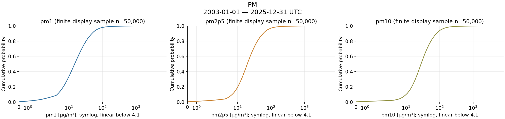

[Biểu đồ PNG](figures/01_pm_distribution.png)

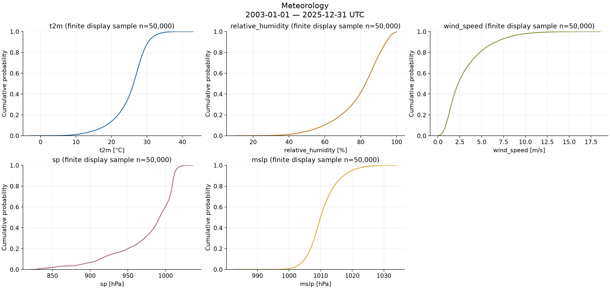

[Biểu đồ PNG](figures/02_meteorology_distribution.png)

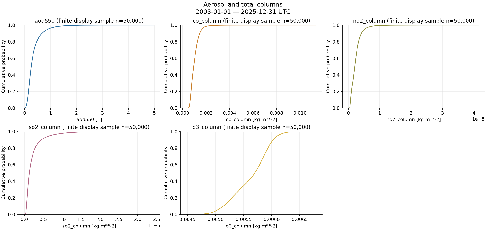

[Biểu đồ PNG](figures/03_aerosol_column_distribution.png)

ECDF dùng tối đa 50,000 điểm grid-time được chọn uniform không thay thế trên từng biến, seed=42; chỉ loại số không hữu hạn khỏi mẫu hiển thị. Summary và ngưỡng extreme không dùng mẫu này. Với mẫu không âm có P99 >5×median và max >10×P99, trục x dùng symlog (linear gần zero, ngưỡng ghi ngay trên axis) để thấy cả thân phân phối và upper tail. Giá trị và thống kê giữ nguyên; mẫu có giá trị âm dùng trục linear.
Nhóm PM cùng unit dùng chung range và axis transformation; các nhóm khác unit có thang riêng ghi trên từng panel, không so sánh độ lớn chỉ qua hình học.

## 4. Temporal patterns

pm2p5: climatology trung bình vùng cao nhất tháng 3 (56.97 µg/m³), thấp nhất tháng 7 (17.31 µg/m³).

pm2p5: climatology tại các giờ được quan sát cao nhất lúc 07:00 UTC+7 (38.98 µg/m³). Dữ liệu 3 giờ không xác định được peak giữa các giờ này.

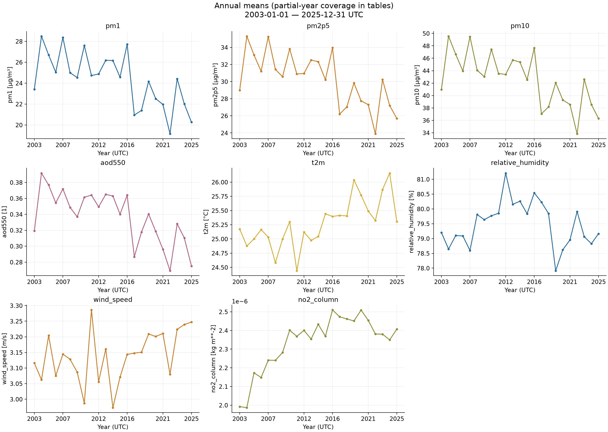

[Biểu đồ PNG](figures/04_annual_area_mean.png)

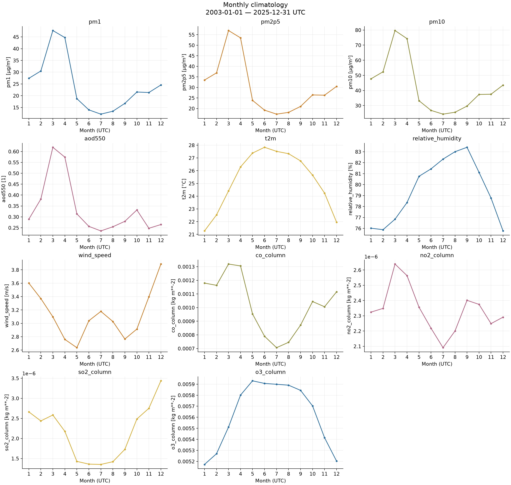

[Biểu đồ PNG](figures/05_monthly_climatology.png)

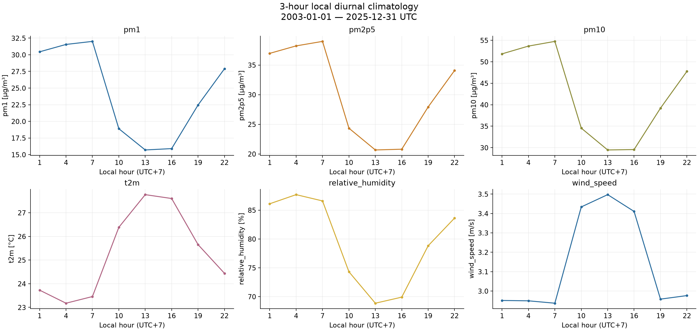

[Biểu đồ PNG](figures/07_local_diurnal_cycle.png)

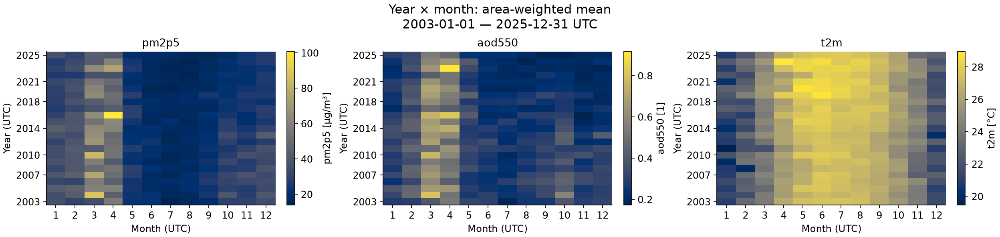

[Biểu đồ PNG](figures/06_year_month_heatmaps.png)

Regional mean dùng cos(latitude) trên số hữu hạn trong bounding box; aggregate daily/monthly/annual từ chuỗi 3-hourly để tránh trung bình các tháng có trọng số không đúng. UTC giữ nguyên; local time = UTC+7 là tọa độ phụ. Climatology dùng quan sát hữu hạn thực tế.
Annual line hiển thị cả năm quan sát thiếu và không được tự xem là trend đã kiểm định. [Annual counts](tables/annual_count.csv), [daily counts](tables/daily_count.csv), [monthly means](tables/monthly.csv), [climatology](tables/monthly_climatology.csv), [local-hour climatology](tables/diurnal.csv).

## 5. Spatial patterns

Ô có mean pm2p5 cao nhất trong bounding box: 21.000°N, 105.750°E (121.7 µg/m³). Đây là ô grid, chưa được xác định là địa điểm hay hotspot trong ranh giới Việt Nam.

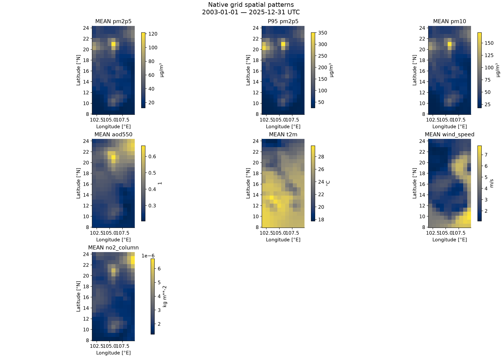

[Biểu đồ PNG](figures/08_spatial_mean_and_p95.png)

Mean/median/std/P95 tính dọc time trên từng ô nguyên bản; tọa độ giữ đúng GRIB, không interpolate hay regrid. Các bảng `tables/spatial_<variable>.csv` chứa grid đã rút gọn, không có raw time axis.

pm2p5: slope annual-grid trong khoảng [-1.742, 0.4184] µg/m³/year, ít nhất 3 năm có coverage ≥95%; chưa kiểm định ý nghĩa thống kê.

aod550: slope annual-grid trong khoảng [-0.01077, -0.0001783] 1/year, ít nhất 3 năm có coverage ≥95%; chưa kiểm định ý nghĩa thống kê.

t2m: slope annual-grid trong khoảng [0.004631, 0.09378] °C/year, ít nhất 3 năm có coverage ≥95%; chưa kiểm định ý nghĩa thống kê.

no2_column: slope annual-grid trong khoảng [-1.147e-08, 1.285e-07] kg m**-2/year, ít nhất 3 năm có coverage ≥95%; chưa kiểm định ý nghĩa thống kê.

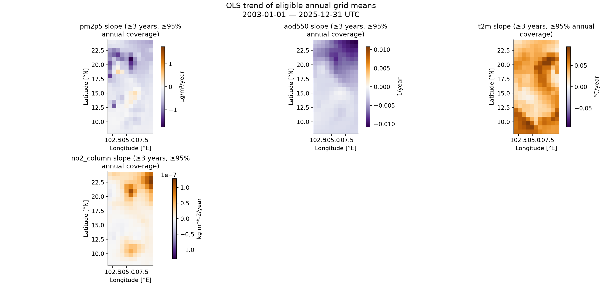

[Biểu đồ PNG](figures/09_annual_grid_trend_slopes.png)

Spatial slope dùng OLS theo calendar year của annual grid mean; một năm tại một ô phải có ít nhất 95% số giá trị 3-hourly kỳ vọng; cần ≥3 năm đủ điều kiện. Các bảng annual_grid_coverage ghi rõ năm bị thiếu. Chưa hiệu chỉnh autocorrelation hay tính p-value, không khẳng định trend có ý nghĩa thống kê.

## 6. Relationships

| variable | pearson_with_pm2p5 | spearman_with_pm2p5 | paired_days |
| --- | --- | --- | --- |
| pm1 | 0.9968 | 0.98746 | 8401 |
| pm10 | 0.99967 | 0.99911 | 8401 |
| wind_speed | 0.0031424 | 0.10409 | 8401 |
| relative_humidity | -0.42984 | -0.60485 | 8401 |
| t2m | -0.23798 | -0.55803 | 8401 |
| aod550 | 0.75759 | 0.7729 | 8401 |
| co_column | 0.7017 | 0.80748 | 8401 |
| no2_column | 0.40314 | 0.19211 | 8401 |
| so2_column | 0.43148 | 0.65981 | 8401 |
| o3_column | -0.23937 | -0.48867 | 8401 |

Daily mean PM2.5 với pm1: Pearson=0.997, Spearman=0.987, 8,401 ngày ghép hữu hạn; association mô tả.

Daily mean PM2.5 với pm10: Pearson=1.000, Spearman=0.999, 8,401 ngày ghép hữu hạn; association mô tả.

Daily mean PM2.5 với wind_speed: Pearson=0.003, Spearman=0.104, 8,401 ngày ghép hữu hạn; association mô tả.

Daily mean PM2.5 với relative_humidity: Pearson=-0.430, Spearman=-0.605, 8,401 ngày ghép hữu hạn; association mô tả.

Daily mean PM2.5 với t2m: Pearson=-0.238, Spearman=-0.558, 8,401 ngày ghép hữu hạn; association mô tả.

Daily mean PM2.5 với aod550: Pearson=0.758, Spearman=0.773, 8,401 ngày ghép hữu hạn; association mô tả.

Daily mean PM2.5 với co_column: Pearson=0.702, Spearman=0.807, 8,401 ngày ghép hữu hạn; association mô tả.

Daily mean PM2.5 với no2_column: Pearson=0.403, Spearman=0.192, 8,401 ngày ghép hữu hạn; association mô tả.

Daily mean PM2.5 với so2_column: Pearson=0.431, Spearman=0.660, 8,401 ngày ghép hữu hạn; association mô tả.

Daily mean PM2.5 với o3_column: Pearson=-0.239, Spearman=-0.489, 8,401 ngày ghép hữu hạn; association mô tả.

pm1_pm2p5_ratio: mean=0.7602, median=0.8124; mẫu số ≤0 hoặc không hữu hạn tạo NaN (51,342 missing ratio, bao gồm missing đầu vào).

pm2p5_pm10_ratio: mean=0.7014, median=0.7094; mẫu số ≤0 hoặc không hữu hạn tạo NaN (51,340 missing ratio, bao gồm missing đầu vào).

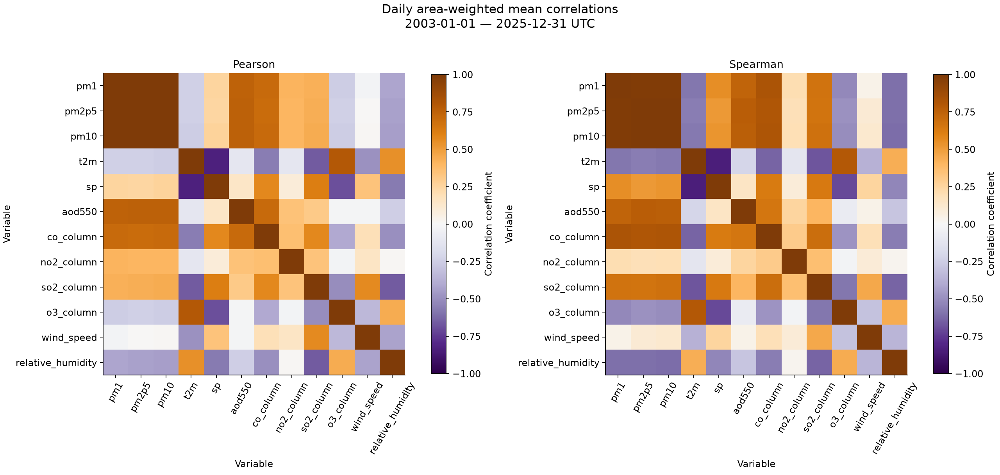

[Biểu đồ PNG](figures/12_daily_correlation_matrices.png)

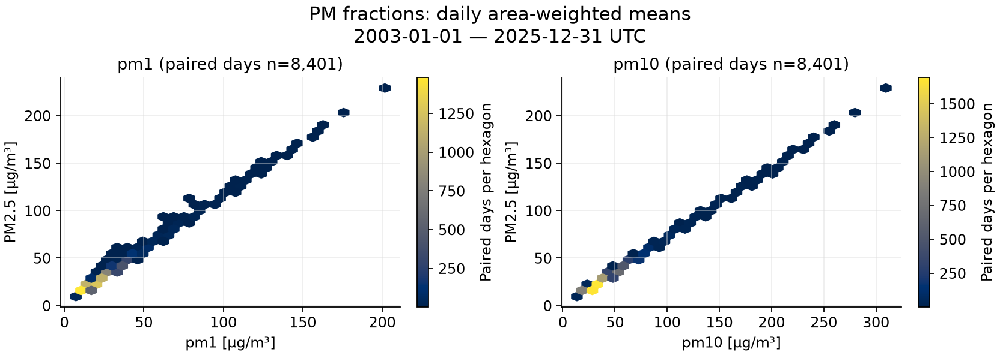

[Biểu đồ PNG](figures/10_pm_fraction_relationships.png)

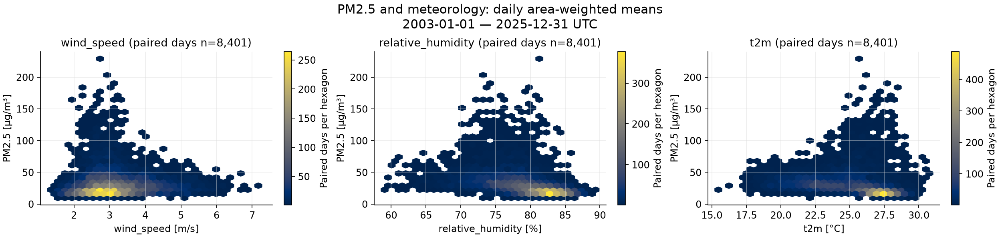

[Biểu đồ PNG](figures/11_pm25_meteorology_relationships.png)

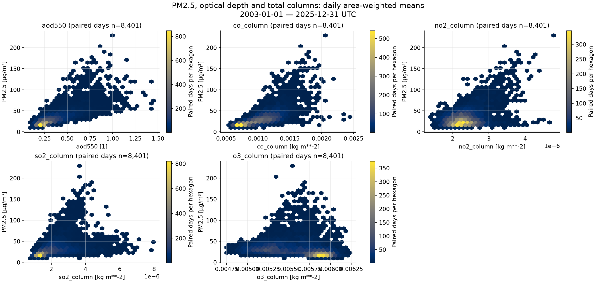

[Biểu đồ PNG](figures/13_pm25_aerosol_column_relationships.png)

| season | paired_days | pearson | spearman |
| --- | --- | --- | --- |
| DJF | 2076 | 0.70074 | 0.72439 |
| MAM | 2116 | 0.68644 | 0.83213 |
| JJA | 2116 | 0.86008 | 0.83983 |
| SON | 2093 | 0.78521 | 0.73509 |

Pearson/Spearman dùng daily area-weighted means của các biến có cùng time và spatial grid, pairwise finite với ít nhất 3 ngày; pair-count matrix được lưu để audit. Daily aggregation giảm số điểm nhưng không loại bỏ autocorrelation/seasonality. [Pearson](tables/pearson.csv), [Spearman](tables/spearman.csv), [paired days](tables/correlation_paired_days.csv).
PM ratio tính ở grid/time trước khi aggregate; mẫu số ≤0/nonfinite cho NaN và không impute.
PM2.5 là near-surface mass concentration; AOD550 là column-integrated optical property, dimensionless khi metadata xác nhận. Association không chứng minh quan hệ 1:1 hay phép đổi AOD thành PM2.5.
CO, NO2, SO2, O3 trong project là **total column**; unit giữ theo metadata, không phải surface concentration và không đổi tùy tiện sang µg/m³.

## 7. Extreme PM2.5

Ngưỡng pooled PM2.5: P95=78.95, P99=167.2 µg/m³. Tổng timestamp có ít nhất một ô vượt ngưỡng: 45,620 (>P95) và 22,881 (>P99).

wind_speed: mean tại điểm normal=3.186, tại điểm PM2.5 >P95=1.934 m/s; so sánh đồng vị trí/thời điểm, chưa điều chỉnh mùa hoặc địa lý.

relative_humidity: mean tại điểm normal=79.49, tại điểm PM2.5 >P95=79.2 %; so sánh đồng vị trí/thời điểm, chưa điều chỉnh mùa hoặc địa lý.

t2m: mean tại điểm normal=25.42, tại điểm PM2.5 >P95=21.32 °C; so sánh đồng vị trí/thời điểm, chưa điều chỉnh mùa hoặc địa lý.

aod550: mean tại điểm normal=0.3122, tại điểm PM2.5 >P95=0.8426 1; so sánh đồng vị trí/thời điểm, chưa điều chỉnh mùa hoặc địa lý.

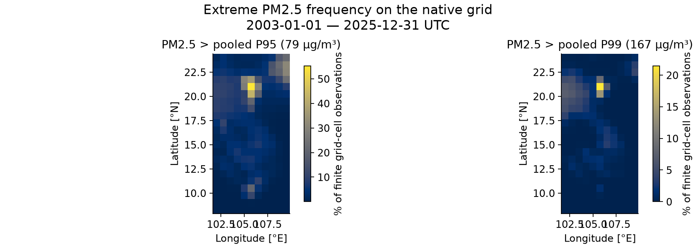

[Biểu đồ PNG](figures/17_pm25_extreme_spatial_frequency.png)

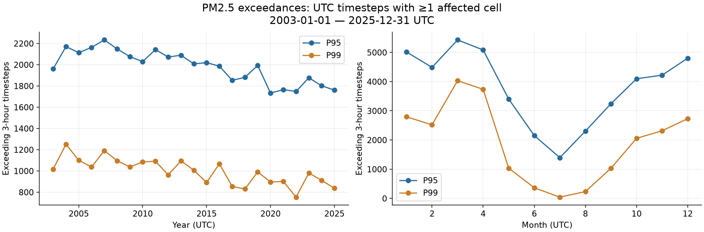

[Biểu đồ PNG](figures/16_pm25_extreme_event_counts.png)

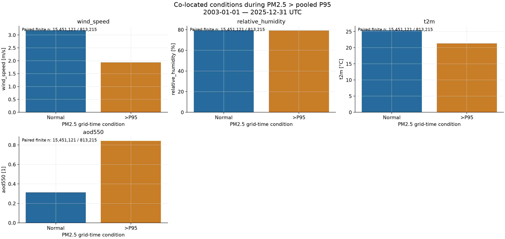

[Biểu đồ PNG](figures/18_pm25_extreme_conditions.png)

| variable | unit | normal_mean | extreme_mean | normal_count | extreme_count |
| --- | --- | --- | --- | --- | --- |
| wind_speed | m/s | 3.1858 | 1.9344 | 1.5451e+07 | 8.1322e+05 |
| relative_humidity | % | 79.487 | 79.201 | 1.5451e+07 | 8.1322e+05 |
| t2m | °C | 25.422 | 21.317 | 1.5451e+07 | 8.1322e+05 |
| aod550 | 1 | 0.31225 | 0.84265 | 1.5451e+07 | 8.1322e+05 |

Ngưỡng P95/P99 là percentile pooled trên các điểm PM2.5 grid × time hữu hạn toàn giai đoạn. So sánh strict `>`; một extreme timestep là timestamp UTC có **ít nhất một ô** vượt ngưỡng, khác với ngưỡng trên regional mean. Spatial frequency chia số vượt ngưỡng cho số quan sát hữu hạn tại chính ô đó. Counts theo năm/tháng có tỷ lệ và finite timestep denominator trong bảng CSV.
Normal = PM2.5 ≤P95; conditions so sánh co-located grid-time finite observations, trọng số mỗi điểm bằng nhau, chưa điều chỉnh mùa/địa lý. Không suy luận causal relationship hay dùng đây như ngưỡng tiêu chuẩn chất lượng không khí.

## 8. Modeling implications

Kết quả association, climatology và spatial slope ở trên là gợi ý chuẩn bị feature, chưa chứng minh sức mạnh dự báo. Kiểm tra thêm local-hour/month/season, các đặc trưng meteorology/AOD có sẵn và PM fraction redundancy bằng validation theo thời gian.
Daily autocorrelation và spatial effects cần temporal holdout, geographic holdout hoặc blocked validation; random split grid-time có thể đánh giá quá lạc quan.
Ngưỡng percentile, climatology, normalization thống kê và feature selection phải fit chỉ trên training period. Không dùng PM contemporaneous fractions hoặc future rolling statistics khi target là PM2.5 nếu thông tin đó không có tại thời điểm dự báo. EAC4 là reanalysis hồi cứu: kiểm tra độ trễ/khả dụng của feature trong deployment thực tế. Không train model trong pipeline này.

## 9. Data limitations

EAC4 là reanalysis, không thay thế quan trắc tại trạm. Grid resolution giới hạn diễn giải ở cấp địa điểm; ô có giá trị cao nhất bounding box chưa được xác nhận nằm trong ranh giới Việt Nam. Không có boundary overlay tải từ Internet.
Total-column pollutants không phải surface concentrations; AOD không phải PM2.5. Correlation không đồng nghĩa causation. RH dùng xấp xỉ saturation over liquid water không clipping; đọc check range và RH violations trước khi sử dụng.
Thiếu file, time gaps, nonfinite data hoặc mismatched grids làm giảm phạm vi phân tích; các phần phụ thuộc hiển thị skipped. Không regrid, interpolate, xóa outlier, chỉnh raw hay export toàn bộ raw grid sang CSV.

## 10. Key findings

1. Đọc được 14/14 biến khai báo: pm1, pm2p5, pm10, u10, v10, t2m, d2m, sp, mslp, aod550, co_column, no2_column, so2_column, o3_column. Thiếu: không có. Giai đoạn quan sát: 2003-01-01 00:00:00 — 2025-12-31 21:00:00 UTC.
2. So với pm1, 14/14 biến cùng trục thời gian và 14/14 biến cùng grid theo đúng thứ tự tọa độ. Tổng timestamp thiếu so với giai đoạn cấu hình (cộng qua biến): 0; message trùng: 224.
3. Các message trùng: 224 bản có cùng decoded values/grid với bản đầu, 0 bản xung đột. Bản giống nhau dùng representation đầu của cfgrib có audit rõ ràng; bản xung đột không được dùng cho analysis liên biến.
4. pm2p5: mean=30.47, median=19.5, P95=78.95, P99=167.2, max=6903 µg/m³; 16,264,336 giá trị hữu hạn.
5. pm2p5: climatology trung bình vùng cao nhất tháng 3 (56.97 µg/m³), thấp nhất tháng 7 (17.31 µg/m³).
6. Ô có mean pm2p5 cao nhất trong bounding box: 21.000°N, 105.750°E (121.7 µg/m³). Đây là ô grid, chưa được xác định là địa điểm hay hotspot trong ranh giới Việt Nam.
7. pm2p5: slope annual-grid trong khoảng [-1.742, 0.4184] µg/m³/year, ít nhất 3 năm có coverage ≥95%; chưa kiểm định ý nghĩa thống kê.
8. Daily mean PM2.5 với pm1: Pearson=0.997, Spearman=0.987, 8,401 ngày ghép hữu hạn; association mô tả.
9. Ngưỡng pooled PM2.5: P95=78.95, P99=167.2 µg/m³. Tổng timestamp có ít nhất một ô vượt ngưỡng: 45,620 (>P95) và 22,881 (>P99).
10. 0 <= RH <= 100: 12,763/16,264,336 điểm vi phạm (0.07847%), dữ liệu giữ nguyên để xem xét.

Trạng thái các phần phụ thuộc dữ liệu:

| section | status |
| --- | --- |
| wind | computed on exactly matching grids and time axes |
| relative_humidity | computed on exactly matching grids and time axes |
| relationships | daily area-weighted means; pairwise finite days; descriptive correlations, no causal inference |
| extreme_pm25 | pooled finite grid-time P95/P99; strict >; a timestep event means at least one exceeding cell; conditions compare co-located finite grid-time points |

[Trạng thái CSV](tables/section_status.csv). Reproduce: mở `notebooks/01_cams_eac4_eda.ipynb` và Run All hoặc `python -m src.eda`.
